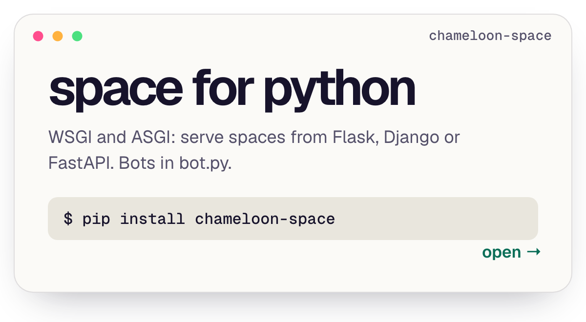
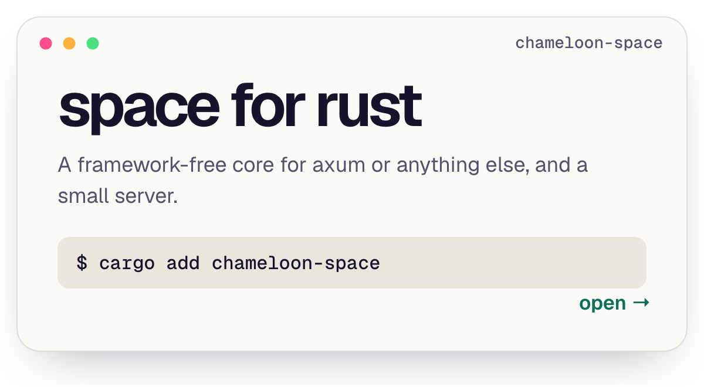
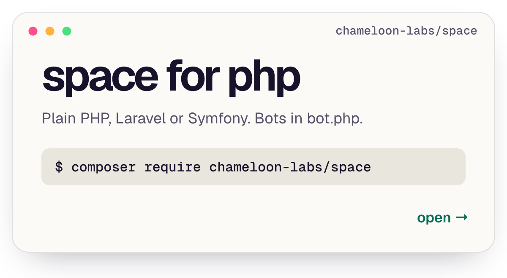

  
  

  
  
  
  

Every server passes the same <a href="https://github.com/Chameloon-Labs/conformance">conformance tests</a>. Another language? The <a href="https://chameloon.com/docs/protocol/">protocol</a> is all you need.

  
  

